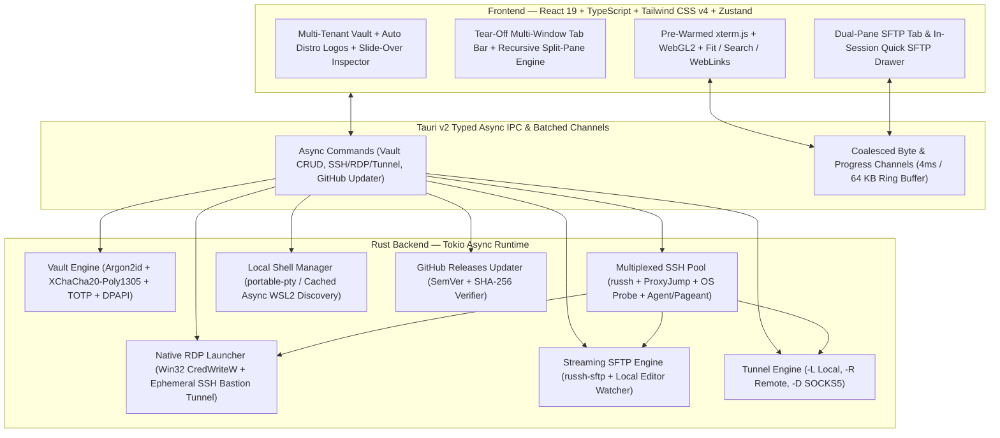

# SkynetSSH (`SKYNET//SSH`) — v1.0

> **Tabby's** ultra-fast split-pane & tear-off multi-window terminal feel + **Termius's** visual Host Vault, automatic Linux Distro logos, Native Windows RDP, Dual-Pane SFTP, Port Forwarding, and Shared Snippets — built natively on **Tauri v2 + Rust** with **$0/month** end-to-end encrypted SharePoint, OneDrive, & Git sync.

[](https://github.com/jfmartineau45/skynetssh/releases/latest)
[](https://github.com/jfmartineau45/skynetssh/actions/workflows/ci.yml)

-DEA584?logo=rust&logoColor=white)


---

## Quick Download (Windows 10 / 11 x64)

Grab the latest installer from [**GitHub Releases**](https://github.com/jfmartineau45/skynetssh/releases/latest):

- **Recommended Per-User Setup (`~6.3 MB`):** `SkynetSSH_<version>_x64-setup.exe` *(supports 1-click silent in-app updates)*
- **Enterprise / GPO MSI (`~9.8 MB`):** `SkynetSSH_<version>_x64_en-US.msi`
- **Checksums:** `SHA256SUMS.txt` *(verified automatically by the built-in updater before running any update)*

---

## Why SkynetSSH?

- **Tabby** nails dark acrylic split panes, **but** runs on heavy Electron (~500+ MB RAM) and buries SSH/RDP management in settings menus.
- **Termius** nails the visual Host Vault, distro badges, SFTP, snippets, and port forwarding, **but** locks core sync and team workflows behind a recurring per-seat subscription.
- **SkynetSSH v1.0** unites SSH2, Native Windows RDP, Dual-Pane SFTP, SOCKS5/Port-Forwarding, Multi-Window Tear-Off Consoles, and Zero-Knowledge Team Vault Sync inside a **~6 MB native Rust binary**.

---

## Key Capabilities

### 1. Termius-Style Multi-Tenant Host Vault & Automatic Distro Logos
- **Dense List & Card Views + Collapsible Tenant Groups:** Organize hundreds of client or environment machines into color-coded **Tenant / Group** sections with `#tag` filters, `All / SSH / RDP` protocol pills, multi-select bulk actions, and non-blocking hover reachability & latency badges (including 3-ping cold-VPN warmup for `198.x` / `100.x` / WAN tunnels).
- **Automatic Linux Distro & OS Brand Logos:** Automatically probes `/etc/os-release`, Proxmox VE (`pveversion`), Synology DSM, and `uname -s` on SSH connect and renders vector logos (**Ubuntu, Debian, Proxmox VE, Rocky, AlmaLinux, RHEL, Fedora, CentOS, Alpine, Arch, Kali, openSUSE, Raspberry Pi OS, Amazon Linux, NixOS, Synology, FreeBSD, macOS, Windows, and Linux**) across Vault rows/cards, tabs, pane headers, and Command Palette.
- **Smart Quick-Connect & Save:** Paste `ssh -p 2222 ubuntu@10.0.1.5`, `rdp://CONTOSO\Admin@10.20.1.50`, `mstsc /v:10.20.1.50:3390`, or IPv6 `root@[2001:db8::1]:2200` into the top bar or `+` menu to parse, save, and launch in one step.
- **1-Click Migration:** Auto-sniffs `~/.ssh` keys & `~/.ssh/config` hosts on launch and imports **Termius JSON** exports.

### 2. Native Windows RDP (`mstsc`) + Zero-Prompt Vault Login + Auto SSH Bastion Tunnel
- **Zero-Prompt Win32 Session Credentials:** Injects AEAD-decrypted Vault passwords directly into Windows Credential Manager via Win32 `CredWriteW` (`TERMSRV/<host>`, `CRED_PERSIST_SESSION`, zeroized UTF-16LE memory) and automatically purges the credential via `CredDeleteW` when `mstsc.exe` exits—passwords never touch `.rdp` files or CLI arguments.
- **1-Click RDP Over SSH Jump Host:** Assign any Linux SSH Bastion as the Jump Host on a private LAN Windows VM; SkynetSSH automatically opens an ephemeral local `127.0.0.1:<port> -> <target>:3389` `direct-tcpip` tunnel over `russh`, launches `mstsc.exe` against the tunnel, and tears the listener down cleanly on disconnect.
- **Display Modes:** Choose **Smart Window** (`smart sizing` + `dynamic resolution`), **Fullscreen**, or **All Monitors** (`use multimon`).

### 3. Zero-Pause Multi-Window Tear-Off, Pop-Out & Recursive Split Panes
- **Live Chrome-Style Tab Tear-Off:** Drag any terminal tab outside the 40px TitleBar (or press `Ctrl+Shift+O`) to detach it into a pre-warmed hardware-accelerated native window with **zero connection drop** and **64 KB ring-buffer output replay**.
- **Multi-Tab & Split-Tree Dock-Back:** Open additional consoles or split panes inside a Pop-Out window, then click **`↙ Dock All`** (or dock individual tabs) to merge every console and split layout seamlessly back into your Main window.
- **Recursive Split Panes & Broadcast Mode:** Split horizontally/vertically (`Alt+Shift+D` / `Alt+Shift+E`), un-split panes back into tabs, and mirror keystrokes across multiple servers simultaneously with **Broadcast**.
- **Auto-Discovered Local Shells:** Detects **PowerShell 7 (`pwsh`)**, **Windows PowerShell**, **Git Bash**, **CMD**, and installed **WSL2** distros off the UI thread via Windows ConPTY.

### 4. Personal & Team Multi-Vaults (Zero-Knowledge SharePoint / OneDrive / Git Sync)
- **Two-Tier Envelope Encryption (`Argon2id` + `XChaCha20-Poly1305`):**
  1. Master Password derives a 256-bit Key Encryption Key via **`Argon2id`** (64 MiB memory, 3 iterations).
  2. Wraps a random 256-bit Master `DEK` in `vault.meta.json`, with optional Windows DPAPI device leases strictly capped at **30 days max**.
  3. **RFC 6238 Authenticator (TOTP) Unlock:** Unlock enrolled devices with a **6-digit TOTP code** or **Master Password**, protected by a **3-strike automatic credential wipe**.
  4. Every host, SSH key, group, tunnel, snippet, and known-host fingerprint is encrypted in its own AAD-bound `<uuid>.enc.json` file.
- **Conflict-Free SharePoint / OneDrive Sync:** Atomic temp writes, `OneDrive.exe` lock-retry backoff, deterministic Last-Writer-Wins healing of `-{COMPUTERNAME}.enc.json` conflict copies, automatic **Read-Only Member** detection on restricted SharePoint folders, and live filesystem watching.

### 5. Dual-Pane SFTP + In-Session Quick SFTP Drawer
- **Quick SFTP Drawer:** Slide open SFTP inside any SSH tab reusing the multiplexed SSH session—complete with Windows Explorer drag-and-drop upload, `⚡ Latest` modified triage, `.*` dotfile toggle, 64 KB Quick Peek viewer, **`cd` Here**, **`tail -f` in Terminal**, and **"Edit Locally"** auto-reupload watcher.
- **Dedicated Dual-Pane SFTP Tab:** Transfer `Local <-> Remote` or stream directly **`Remote A <-> Remote B`**.

### 6. Port Forwarding (`-L`, `-R`, `-D` SOCKS5) & `##` Shared Snippets
- **Port Forwarding:** Local (`-L`), Remote (`-R`), and built-in async RFC 1928 **Dynamic SOCKS5 (`-D`)** proxy with live connection telemetry.
- **Inline `##` Snippets Playbook:** Type `##` at any normal shell prompt (automatically disabled inside `nano`, `vim`, `tmux`, and `htop` alternate buffers!) to fuzzy-pick team snippets with `{{variable}}` prompts.

### 7. Built-In GitHub Release Update Detection & 1-Click Auto-Updater
- Automatically checks `github.com/jfmartineau45/skynetssh/releases/latest` on startup (configurable in **Vault -> Settings**).
- Displays a subtle emerald **`⬆ vX.Y.Z`** pill in the TitleBar only when a newer release exists, verifies the downloaded NSIS installer against `SHA256SUMS.txt`, applies the update silently, and relaunches `SkynetSSH`.

---

## TUI-Safe Keyboard Shortcuts

All terminal shortcuts are engineered so bare `Ctrl+<letter>`, `Ctrl+-/_`, `Alt+<key>`, and `F1..F12` pass straight through to `nano`, `vim`, `tmux`, `htop`, `mc`, and `bash`.

| Shortcut | Action |
| :--- | :--- |
| `` Ctrl + ` `` *(Global OS-Wide)* | **Quake Bring-to-Front / Hide Toggle** across all SkynetSSH windows (customizable via **Record Key** in Settings) |
| `Ctrl + Shift + P` *(or `Ctrl + K` outside terminal)* | Open **Command Palette** (hosts, RDP, split-with, shells, SFTP, tunnels, snippets, updates, themes) |
| `Ctrl + Shift + O` *(or Drag Tab Out)* | **Pop Out** active terminal tab into standalone window / **Dock Back** to Main |
| `Alt + Shift + P` | Toggle **Pin Window Always on Top** |
| `Ctrl + Shift + T` | Open new Local Terminal tab |
| `Ctrl + Shift + N` | Open **New Host** slide-over Vault inspector |
| `Ctrl + Shift + W` | Close active tab |
| `Ctrl + Tab` / `Ctrl + Shift + Tab` | Cycle next / previous tab |
| `Ctrl + Alt + 1 .. 9` | Jump directly to Tab 1..9 (`Ctrl+1..9` also works outside `.xterm`) |
| `Alt + Shift + D` / `Alt + Shift + E` | Split active pane **Right** / **Down** (`Shift+Click` header icon = instant duplicate split) |
| `Ctrl + Shift + F` | Toggle inline buffer search inside active terminal pane |
| `Ctrl + Shift + C` / `V` | Copy / Paste in terminal (plus optional **Copy-on-Select** & **Right-Click Paste**) |
| `Ctrl + Alt + =` / `-` / `0` | Zoom terminal font size in / out / reset |
| `##` *(in normal shell prompt)* | Open inline **Shared Snippets** autocomplete picker |

---

## Architecture



---

## Development, Branching & Release Workflow

### Repository Branches
- **`main`** — Production-ready release branch. Tagged releases (`v1.0.0`, `v1.0.1`, ...) are cut from `main`.
- **`develop`** — Integration branch for upcoming features and fixes; verified automatically by `.github/workflows/ci.yml` before merging to `main`.

### Local Development
```bash
pnpm install
pnpm tauri dev
```

### Run Verification Suite
```bash
# TypeScript SSH/RDP/SFTP/Window unit tests + production bundle check
pnpm test
pnpm build

# Rust Vault crypto, TOTP, RDP CredMan, SOCKS5, OS detection & Updater unit tests
cd src-tauri && cargo test --lib
```

### Publishing a New Release (Triggers Automatic In-App Updates)
1. Bump the version in `package.json`, `src-tauri/Cargo.toml`, and `src-tauri/tauri.conf.json` (e.g. `1.0.1`).
2. Commit to `main` and push a SemVer tag:
   ```bash
   git commit -am "chore(release): v1.0.1"
   git tag v1.0.1
   git push origin main --tags
   ```
3. [`.github/workflows/release.yml`](.github/workflows/release.yml) automatically runs tests, compiles `SkynetSSH_1.0.1_x64-setup.exe` + `.msi`, generates `SHA256SUMS.txt`, and publishes the GitHub Release — every installed `SkynetSSH` instance will detect `v1.0.1` and offer a 1-click verified upgrade.

---

## License

[MIT](LICENSE)
