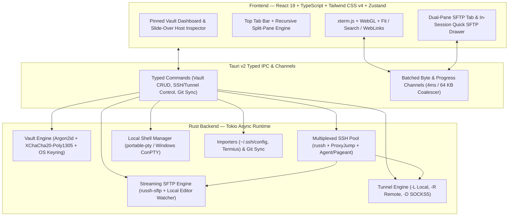

# SkynetSSH (`SKYNET//SSH`)

> **Tabby's** sleek Acrylic split-pane terminal feel + **Termius's** effortless Host Vault, SFTP, Tunnels, and Snippets — built natively on **Tauri v2 + Rust** with **$0/month** end-to-end encrypted Git & folder sync.


-DEA584?logo=rust&logoColor=white)


---

## Why SkynetSSH?

- **Tabby** nails the translucent dark terminal aesthetic and recursive split panes, **but** runs on heavy Electron (~500+ MB RAM) and buries SSH profile creation inside a clunky settings maze.
- **Termius** nails the visual Host Vault, slide-over host inspector, SFTP browser, snippets, and port forwarding, **but** locks core sync/SFTP workflows behind a recurring subscription.
- **SkynetSSH** combines the best of both into a **~6 MB native installer** powered by pure async Rust (`russh`, `russh-sftp`, `portable-pty`) and GPU-accelerated `xterm.js` WebGL panes.

---

## Features

### 1. Termius-Style Host Vault & Slide-Over Inspector
- **Pinned Vault Home Tab:** Organize servers into **Groups** and filterable `#tag` pills, with one-click or double-click launch into SSH or SFTP.
- **Slide-Over Right Host Inspector:** Clean grouped cards for **Address & Group**, **SSH Credentials**, and **ProxyJump / Startup Automation**—create new Groups or generate/import SSH keys **inline** without ever leaving the host form.
- **Smart Quick-Connect & Save Bar:** Paste `ssh -p 2222 ubuntu@10.0.1.5` or IPv6 `root@[2001:db8::1]:2200` into the top bar (or straight into the Address field) to auto-parse credentials, save to the Vault, and connect in one step.
- **1-Click Migration:** Import existing hosts directly from `~/.ssh/config` or a **Termius JSON** export, plus 1-click host card duplication.

### 2. Encrypted Sync-Safe Vault ($0/Month Cloud or Git Sync)
- **Two-Tier Envelope Cryptography:**
  1. Your Master Password derives a 256-bit Key Encryption Key via **`Argon2id`** (64 MiB memory, 3 iterations).
  2. That key wraps a random 256-bit Master Data Encryption Key (`DEK`) in `vault.meta.json`, held in `Zeroizing` memory when unlocked.
  3. Every host, SSH key, group, tunnel, snippet, and known-host fingerprint is encrypted individually with **`XChaCha20-Poly1305`** and AAD header binding (`collection:id:schema:updated_at:tombstone`) into its own `<uuid>.enc.json` file.
- **Conflict-Free Multi-PC Sync:** Because every item lives in its own atomic `<uuid>.enc.json` file (with soft-delete tombstones), syncing your Vault folder via **Git**, **Dropbox**, **Syncthing**, **OneDrive**, or **iCloud** avoids binary SQLite merge corruption.
- **Built-in Git Sync:** Configure a private Git remote in **Sync & Themes** and click **Pull, Commit & Push Now** (with automatic `git rebase --abort` protection on conflicts).
- **OS Keychain Convenience & Hard Lock:** Optional **Windows Credential Manager** caching for instant unlock on launch; clicking the titlebar **Lock** icon purges the key from RAM and Credential Manager, stops active tunnels, disconnects SSH sessions, and wipes temporary SFTP edit files.

### 3. Tabby-Style Multi-Pane Terminal & Local Shells
- **Recursive Binary Split Panes:** Split any tab horizontally or vertically with smooth drag-resizable dividers—freely mixing remote SSH servers and local shells in the same tab.
- **GPU-Accelerated `xterm.js` WebGL:** 10,000-line scrollback, inline buffer search (`Ctrl+Shift+F`), clickable URLs, copy-on-shortcut (`Ctrl+Shift+C`), and 4ms / 64 KB output batching in Rust so `btop`, `vim`, and fast log dumps stay responsive.
- **Auto-Discovered Local Shells:** Automatically detects **PowerShell 7 (`pwsh`)**, **Windows PowerShell**, **Git Bash**, **Command Prompt (`cmd`)**, and installed **WSL2** distributions via Windows ConPTY (`portable-pty`).

### 4. Multiplexed SSH2, Multi-Hop `ProxyJump` & Agent Auth
- **Multiplexed Connections:** A single authenticated `russh` session per host powers multiple terminal panes, SFTP browsers, and tunnels simultaneously without repeated handshakes.
- **In-Memory `ProxyJump` Chaining:** Hop through 1..N bastion servers (`Host C` via `Host B` via `Host A`) purely over virtual `direct-tcpip` streams with loop detection.
- **Flexible Authentication:**
  - **Vault Keychain:** Generate **Ed25519** or **RSA-4096** keys in one click, import `.pem` / OpenSSH files, paste PEM keys (validated with SHA-256 fingerprint & `authorized_keys` public-key extraction), and store key passphrases encrypted in the Vault.
  - **Native SSH Agent:** Connects to Windows OpenSSH `\\.\pipe\openssh-ssh-agent` and **Pageant** (1Password, KeePassXC, PuTTY) before falling back to `~/.ssh` keys.
  - **Password Auth:** Stored encrypted inside your host envelope.
- **Interactive `known_hosts` Verification:** Trust-On-First-Use (TOFU) SHA-256 fingerprint modal and high-visibility Man-In-The-Middle warning if a remote host key ever changes.

### 5. Dual-Pane SFTP + Quick In-Session SFTP Drawer
- **Quick SFTP Drawer:** Toggle a slide-out SFTP browser inside any active SSH tab, reusing the live SSH connection with zero re-authentication.
- **Dedicated Dual-Pane SFTP Tab:** Side-by-side panes where either side can be **Local PC** or **Any Saved Remote Host**—supporting `Local <-> Remote` transfers and direct streamed **`Remote A <-> Remote B`** transfers.
- **Remote File Tools:** Live chunked progress dock, `mkdir`, rename, delete, octal `chmod` permissions modal, and **"Edit Locally"** (downloads to a sanitized temp directory, opens in your default Windows editor via `ShellExecuteW`, watches for saves, and auto-uploads back over SFTP).

### 6. Port Forwarding & Built-In Dynamic SOCKS5 Proxy
- **Local (`-L`):** Bind a local port and forward traffic through SSH `direct-tcpip` to any remote target.
- **Remote (`-R`):** Bind a remote port via `tcpip-forward` and route incoming `forwarded-tcpip` connections back to a local service.
- **Dynamic SOCKS5 (`-D`):** Built-in async RFC 1928 SOCKS5 proxy server (IPv4, IPv6, and domain resolution) over SSH—run tunnels independently in the background with live active-connection counts.

### 7. Snippets, Multi-Host Broadcast, Command Palette & Themes
- **Parameterized Snippets:** Store reusable commands with `{{variable}}` placeholders that prompt for values before running, or attach snippets as automatic host startup commands.
- **Multi-Host Broadcast Mode:** Toggle **Broadcast** in the title bar to mirror keystrokes simultaneously across all selected panes (highlighted with amber tactical borders).
- **Command Palette (`Ctrl+K`):** Fuzzy-search launcher to connect to hosts, open Dual-Pane SFTP, spawn local shells, toggle tunnels, run snippets, or switch themes.
- **5 Built-In Themes (Live-Switching):**
  - **Cyberdyne Obsidian** *(Default — matte carbon glass + crimson T-800 accents)*
  - **T-800 Tactical HUD** *(High-contrast crimson optical HUD)*
  - **Tabby Acrylic Dark** *(Classic Tabby slate + electric sky-blue)*
  - **Termius Midnight** *(Deep navy + emerald vault accents)*
  - **Tokyo Night** *(Low-glare indigo night palette)*

---

## Architecture



### Encrypted Vault Directory Structure
```text
<vault-directory>/
├── vault.meta.json            # Argon2id salt/params + XChaCha20 wrapped 256-bit Master DEK
├── groups/<uuid>.enc.json     # Encrypted group envelopes
├── hosts/<uuid>.enc.json      # Encrypted host credentials & ProxyJump links
├── keys/<uuid>.enc.json       # Encrypted OpenSSH private keys & passphrases
├── tunnels/<uuid>.enc.json    # Encrypted -L / -R / -D port-forwarding rules
├── snippets/<uuid>.enc.json   # Encrypted command templates
└── known_hosts/<uuid>.enc.json# Verified SHA-256 server host-key fingerprints
```

---

## Keyboard Shortcuts

| Shortcut | Action |
| :--- | :--- |
| `Ctrl + K` | Open global **Command Palette** (hosts, shells, SFTP, tunnels, snippets, themes) |
| `Ctrl + Shift + F` | Toggle inline search inside the active terminal pane |
| `Ctrl + Shift + C` | Copy selected terminal text to clipboard |
| `Middle-Click` on Tab | Close terminal or SFTP tab |
| `Double-Click` Host Card | Open new SSH terminal tab for that host |

---

## Getting Started (Development & Build)

### Prerequisites
- **Node.js 22+** and **pnpm**
- **Rust (stable)** via `rustup`
- **Windows:** Edge WebView2 (pre-installed on Windows 11) + MSVC Build Tools or MinGW-w64 + LLVM `lld`

### Install & Run in Dev Mode
```bash
pnpm install
pnpm tauri dev
```

### Run Unit Tests (TypeScript + Rust)
```bash
# Frontend SSH/IPv6 connection-string parser tests
pnpm test

# Backend Argon2id/XChaCha20 Vault, Ed25519 keygen, OpenSSH config & SOCKS5 tests
cd src-tauri && cargo test --lib
```

### Build Production Installer (`~5.9 MiB` NSIS `.exe`)
```bash
pnpm tauri build --bundles nsis
```
The standalone per-user Windows installer is output to:
`src-tauri/target/release/bundle/nsis/SkynetSSH_0.1.0_x64-setup.exe`

---

## License

MIT
